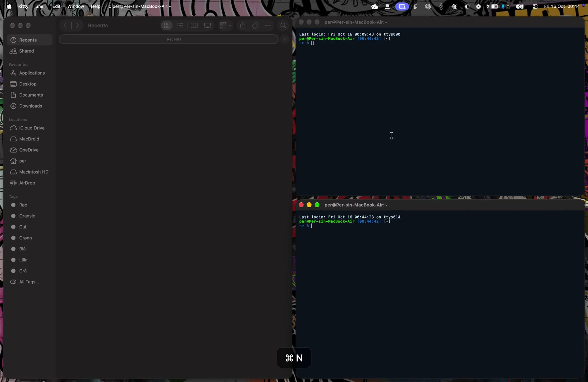
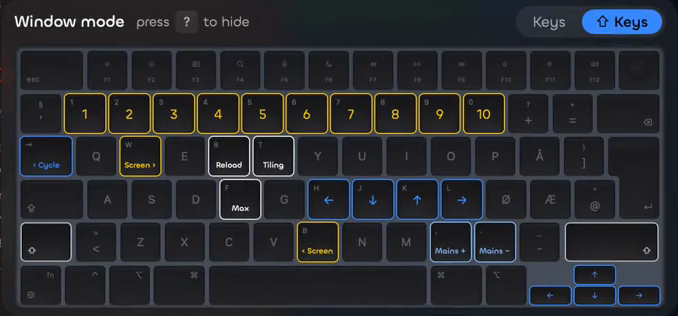
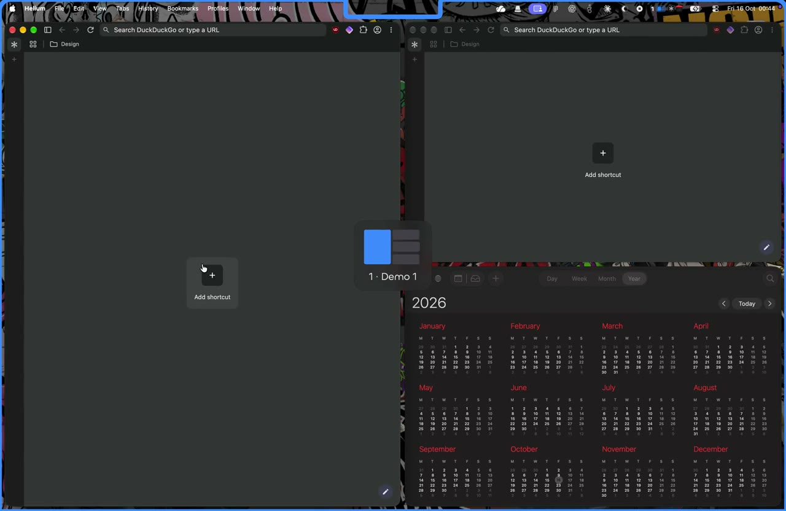
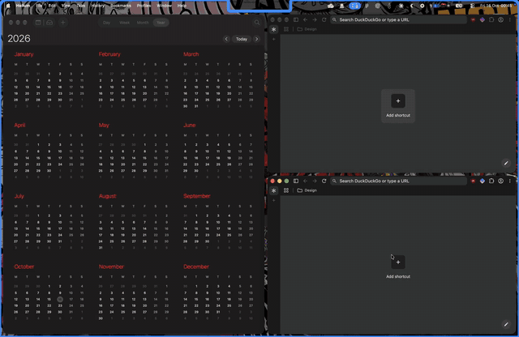
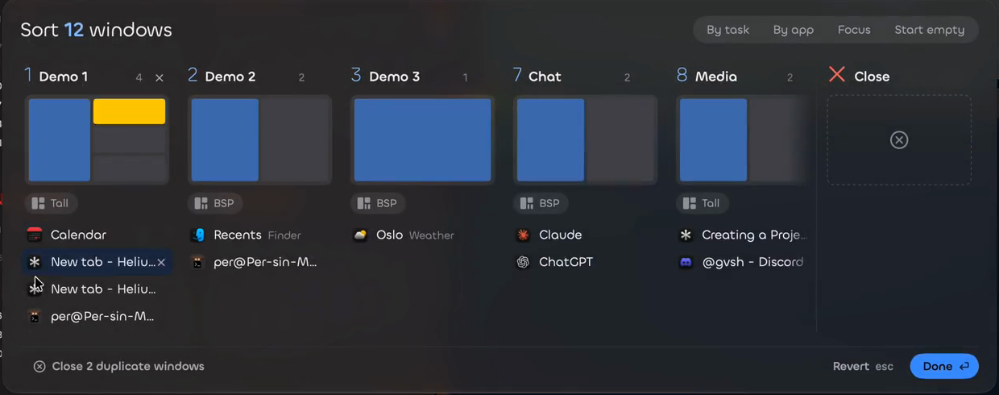

<p align="center">
  
</p>

<h1 align="center">Ouch</h1>

<p align="center">A simple, fast tiling window manager for macOS.</p>

<p align="center">
  <a href="https://ouch.perwko.com"></a>
</p>

## Install

```sh
curl -fsSL https://ouch.perwko.com/install.sh | sh
```

For beta releases, add `-s -- --beta`. Ouch updates itself. Give it the **Accessibility** permission when it asks.

## Window mode

Press ⌘ Caps Lock. Then single keys control your windows. Press Esc or click to leave. Keys with no bind do nothing, so you cannot type into an app by accident.



The keyboard help shows each key that has a bind. To use WASD, select it in Settings → Shortcuts.

## Workspaces

Each display has its own workspaces. Press ⌥ 1 … ⌥ 0 to change workspace, or click the numbers in the menu bar.



## Layouts

Each display has its own layout. In window mode, press N and P to change the layout.



Layouts: `tall`, `wide`, `bsp`, `column`, `row`, `middle-wide`, `two-pane`, `3column-middle`, `fullscreen`, `floating` and more.

## Overview

Press ⌥ O to see all windows on all workspaces. Drag a window to a different workspace, or let Ouch sort them by task or by app.



## Window switcher

Tap ⌥ Tab to go back to the last window. Hold ⌥ to see every window on every workspace and full-screen Space, most recent first. Press Tab and ⇧ Tab to move, and release ⌥ to open the window. Type to search app names, window titles and workspaces. When one window matches, it opens by itself. A window on another workspace switches to that workspace with the Ouch animation.

In the list, press ` to show only the windows of the selected app. ⌘ W closes the selected window, ⌘ Q quits its app, ⌘ H hides its app, and ⌘ 1 … ⌘ 9 open a row. Esc closes the list.

## Make it yours

- **Settings** (⌘, in the menu bar menu) changes layouts, gaps, motion, shortcuts and more.
- **Config file:** `~/.config/ouch/ouch.conf`. Settings edits the same file.

```
$mod = SUPER                                 # use Command as the main key
bind = $mod, 1..0, workspace, 1..10
bind = $mod, mouse_down, workspace, e+1      # scroll to the next workspace
```

Reference: [options](Resources/AgentDocs/config.md) · [binds](Resources/AgentDocs/keybinds.md) · [dispatchers](Resources/AgentDocs/dispatchers.md) · [workspaces](Resources/AgentDocs/workspaces.md) · [command line](Resources/AgentDocs/cli.md) · [troubleshooting](Resources/AgentDocs/troubleshooting.md)

## Feedback

Click the ladybug button in Settings. Ouch shows you all that it sends.

## Contributing

To build Ouch, run the tests or make a release, read [CONTRIBUTING.md](CONTRIBUTING.md).
