# Window session

The `WindowSession` module saves and opens app windows. The app imports it with `import WindowSession`. The module does not know about Ouch workspaces, layouts or Desktops. The code in `Sources/ouch/Templates/` uses the module and changes the Ouch state.

## Module map

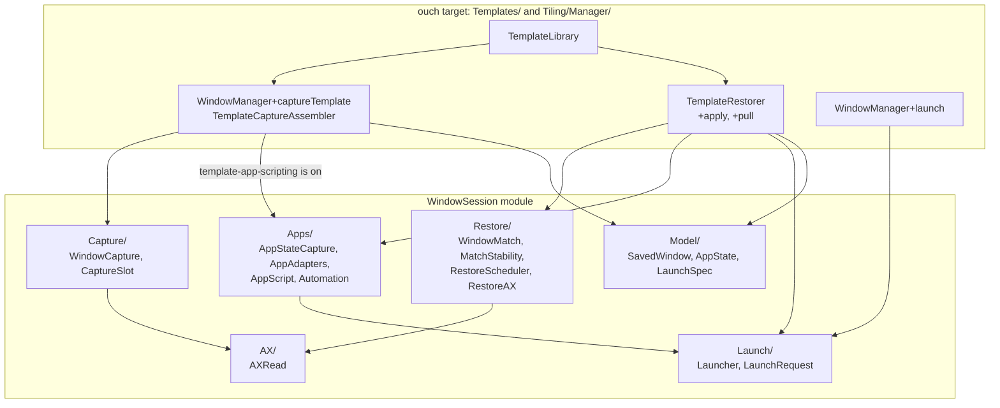

## Saved data

`WorkspaceTemplate` stays in the app. Its `SavedWindow` is the module type. The `state` and `launch` fields are optional, so an old `templates.json` file loads without a change.

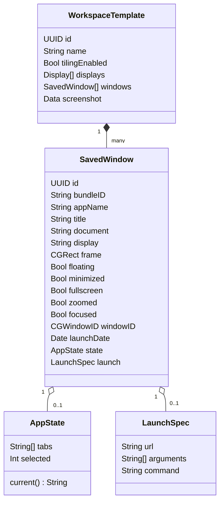

`AppState.tabs` holds one URL for each tab. A browser tab is an `http` or `https` URL. A Terminal tab, an iTerm2 tab or a Finder window is a `file` URL of a folder.

## Save a template

The AX read has a budget of 2 seconds, with a backstop of 2.6 seconds. The app state step runs only when `template-app-scripting` is on. It runs after the AX read, so it cannot make the AX read time out.

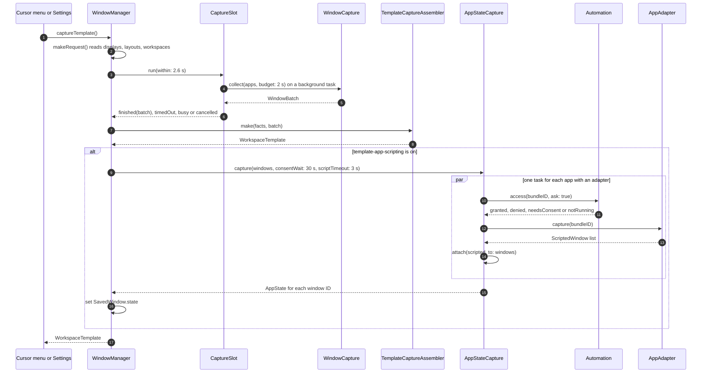

### Pair a scripted window with an AX window

A script gives a title and a frame for each window. It does not give a `CGWindowID`. `AppStateCapture.attach` finds the pairs. It sorts all pairs by cost and takes the lowest cost first. Each window and each scripted window is used one time.

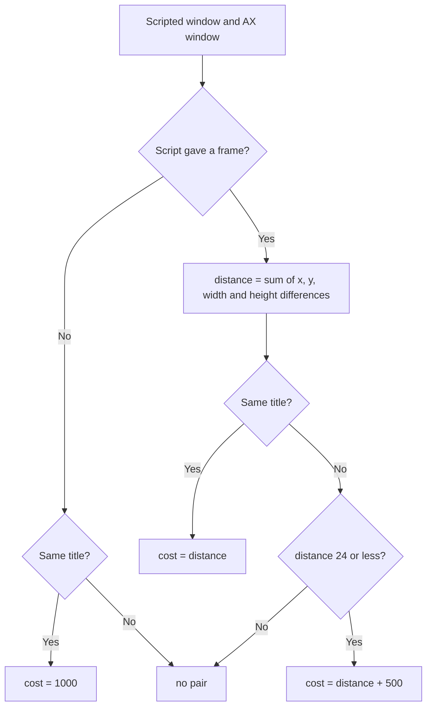

## App adapters

An adapter reads the state of one app and opens it again. JavaScript for Automation (JXA) reads the state and returns JSON. AppleScript opens the state. `AppScript` runs each script in an `osascript` process. A timer stops the process at the timeout, so an app that does not respond cannot stop Ouch.

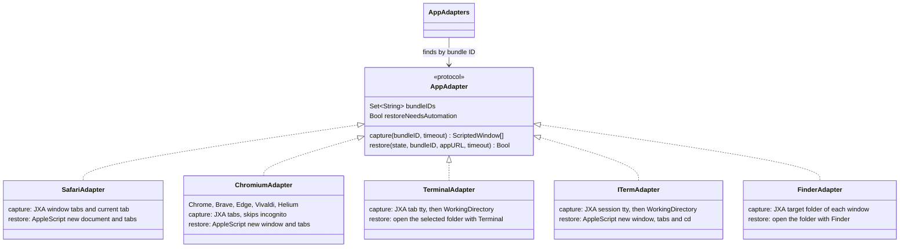

`WorkingDirectory` finds the folder of a terminal tab without a script. It reads the device of the tty, finds the foreground process group of that tty with `sysctl`, and reads the current folder of that process with `proc_pidinfo`.

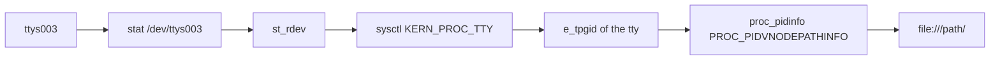

### Automation access

`Automation.access` calls `AEDeterminePermissionToAutomateTarget`. That call can wait for the user, so `Blocking.run` runs it on a background queue and returns a fallback at the timeout.

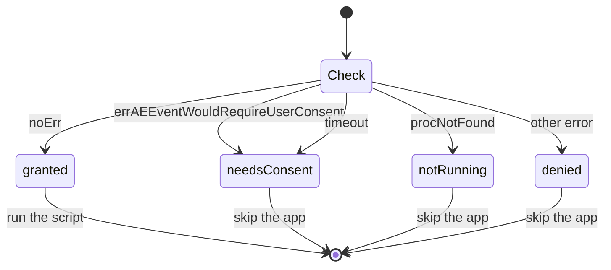

A save asks the user (`ask: true`). An open never asks (`ask: false`). If an adapter needs Automation and the app does not allow it, the open uses the next way in the list below.

## Open a template

`TemplateRestorer.restore()` has two phases. `discover()` finds or opens a window for each saved window. `apply()` moves the windows to their Desktops, sets the layouts and places the frames.

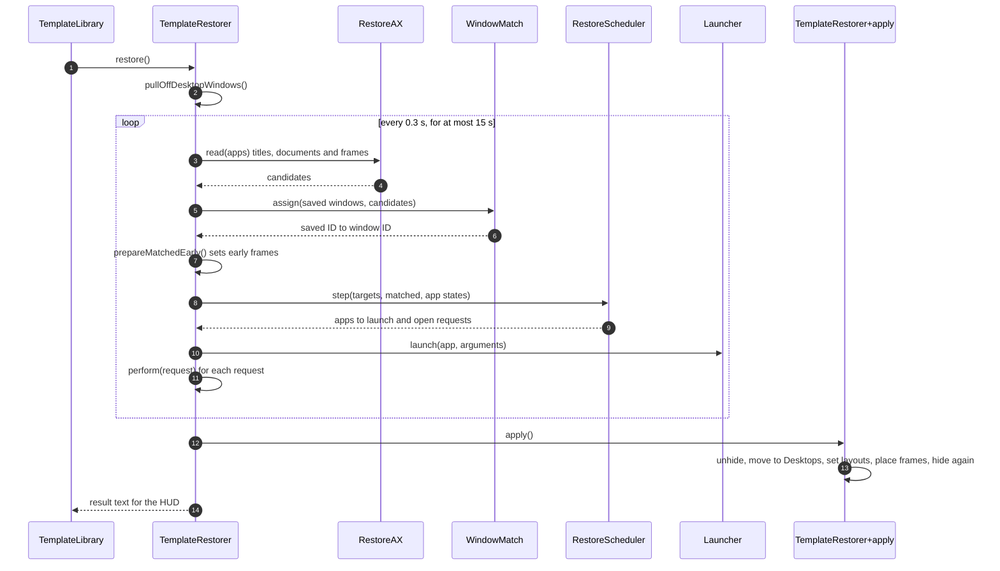

### One request

Each request opens one saved window. `perform` uses the first way that applies.

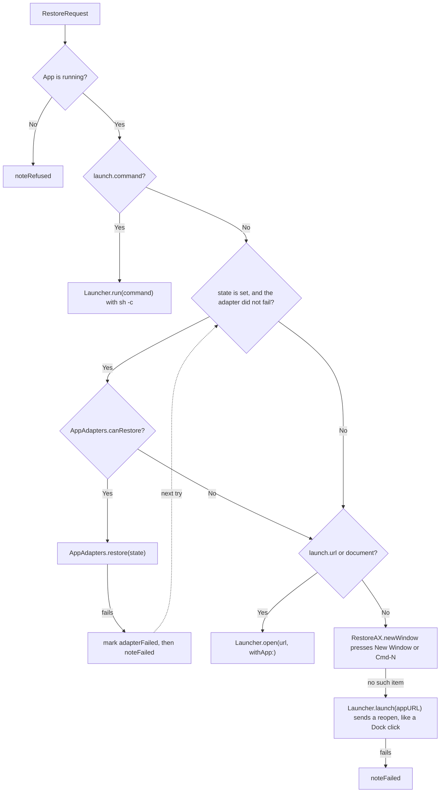

Some apps, such as Electron apps, have no "New Window" item and no Cmd-N. For these apps, Ouch sends a reopen request to the running app, without bringing it to the front. This is the same request that a Dock click sends, and the app makes a window. The request then stays pending until the window appears.

A failed request can try again after 0.5 seconds. It can try 3 times. A started command or a started open does not try again, so a slow app does not get two windows.

### Scheduler phases for one app

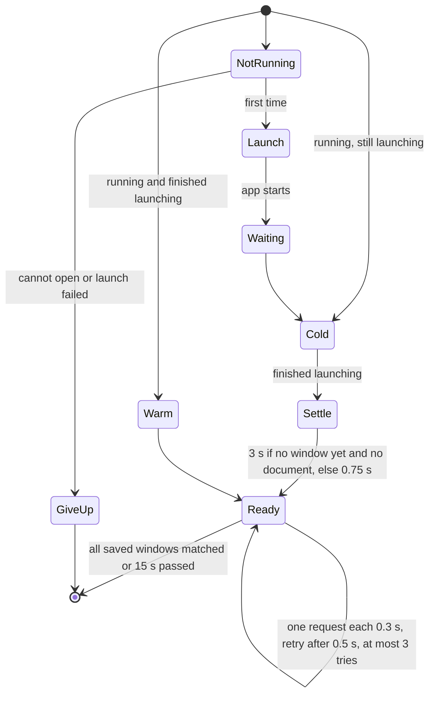

The 3-second wait lets an app bring back its own windows (macOS Resume) before Ouch opens new ones. `WindowMatch` then pairs those windows with the saved windows.

### Match windows

`WindowMatch.assign` runs in four rounds, from the best score to the lowest. In each round it sorts all pairs that fit. A pair with a nearer frame comes first. If two pairs have the same distance, the saved window that was made first gets the window that was made first.

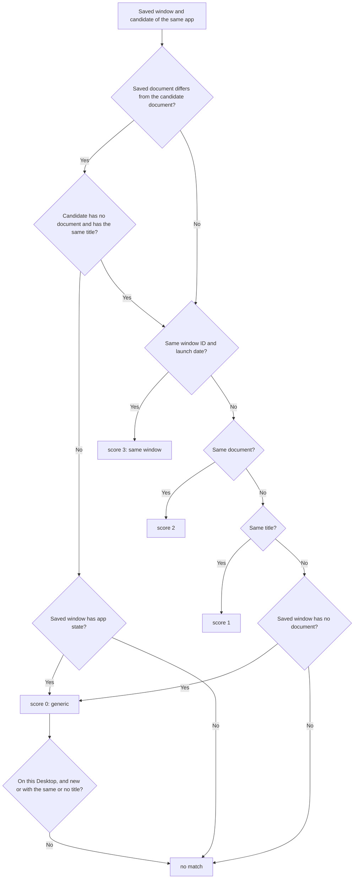

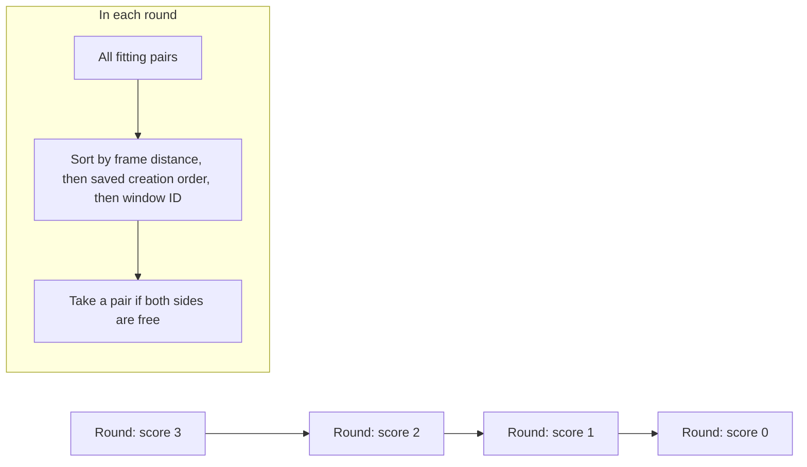

A window that a script opened can show another URL while it loads. A saved window with app state can therefore match a new window at score 0. `MatchStability` waits until a score 0 or score 1 match stays the same for 0.6 seconds, but not more than 2 seconds. It ignores frame changes, so an early frame write does not restart the wait.

## The launch dispatcher

`bind = $mod, T, launch, Terminal workspace=2 frame=0,0,50%,100%`

`LaunchRequest` reads the options from the end of the argument. A word with `=` that is not `workspace`, `display` or `frame` stays in the target, so a URL with a query works. The CLI cannot run `launch`, because it can open a `.command` file.

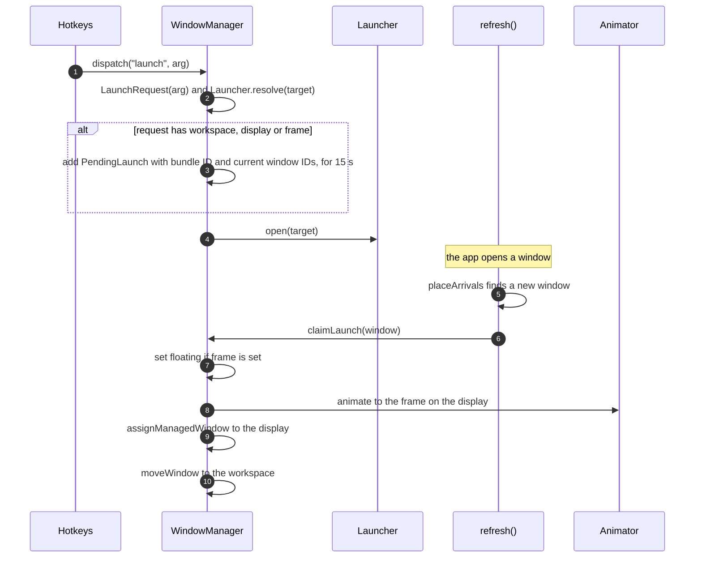

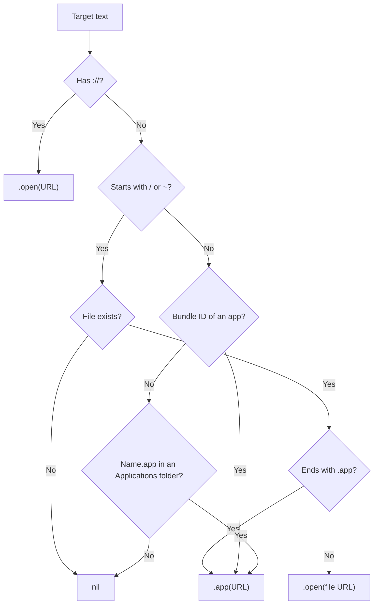
